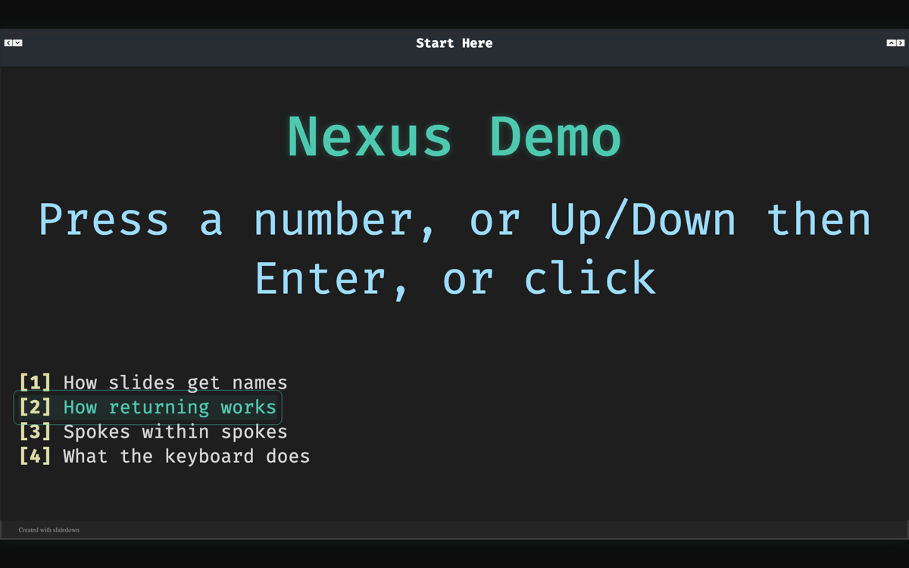
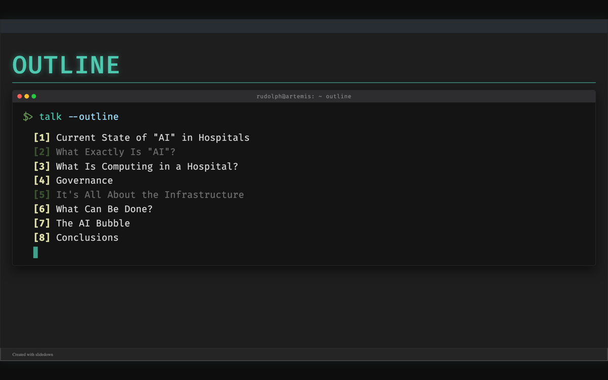

# Slidedown

Slidedown is a text-first presentation compiler. You write a plain text
`.sd` file with simple `.directive{content}` markup, and slidedown compiles it
to a browser-based HTML presentation.

It is meant for people who want slide decks that behave more like source code:
diffable, scriptable, easy to version, and still capable of presentation
effects such as progressive reveals, typewriter text, code highlighting,
themes, and custom CSS.

View the README as an interactive presentation — pick a theme:

| Theme | Live Demo |
|---|---|
| `command-line` | https://fnndsc.github.io/slidedown/themes/command-line/ |
| `conventional-light` | https://fnndsc.github.io/slidedown/readme-presentation/ |
| `default` | https://fnndsc.github.io/slidedown/themes/default/ |
| `lcars-lower-decks` | https://fnndsc.github.io/slidedown/themes/lcars-lower-decks/ |
| `retro-terminal` | https://fnndsc.github.io/slidedown/themes/retro-terminal/ |
| `terminal` | https://fnndsc.github.io/slidedown/themes/terminal/ |

## Quick Start

Slidedown is primarily managed through its `Makefile`. That path assumes your
system has `make` available.

On Linux and macOS, `make` is usually available through the system package
manager or developer tools. On Windows, use WSL, MSYS2, Git Bash, or another
environment that provides GNU Make. The Makefile also detects Android/Termux
and uses `pip` there instead of `uv pip`.

From a fresh checkout:

```bash
make dev
```

Compile and serve an example deck:

```bash
make presentation SOURCE=examples/minimal/minimal.sd
```

The first command creates `.venv` and installs slidedown in editable mode. The
second command compiles the deck and serves it at:

```text
http://localhost:8000
```

Compile without serving:

```bash
make compile SOURCE=examples/minimal/minimal.sd
```

Serve an already compiled deck:

```bash
make serve SOURCE=examples/minimal/minimal.sd
```

Change the theme or port:

```bash
make presentation \
  SOURCE=examples/watermarked/light-watermarks-demo.sd \
  THEME=conventional-light \
  PORT=9000
```

See all Makefile targets:

```bash
make help
```

If you are on a system without `make`, the equivalent manual path is:

```bash
python3 -m venv .venv
.venv/bin/pip install -e ".[dev]"
.venv/bin/slidedown examples/minimal/ output/ \
  --inputFile minimal.sd \
  --theme conventional-light
cd output/
python3 -m http.server 8000
```

## Minimal Example

```slidedown
.slide{
  .title{Hello Slidedown}
  .body{
    .typewriter{> Welcome...}

    .bf{Why use it?}
    .o{Text-first authoring}
    .o{Progressive reveal bullets}
    .o{Browser-native presentation output}
  }
}
```

## Core Syntax

Slidedown content is built from directives:

```slidedown
.directive{content}
.directive{.modifier{value} content}
.directive{nested .directives{work} too}
```

Common structural directives:

- `.slide{}` defines one slide
- `.title{}` defines the slide title
- `.body{}` defines the visible slide content

Common formatting and behavior directives:

- `.bf{}` bold text
- `.em{}` italic text
- `.tt{}` monospace text
- `.code{}` highlighted code block
- `.typewriter{}` typing animation
- `.o{}` progressive reveal bullet/snippet
- `.nexus{}` / `.jump{}` hub-and-spoke menus (see [Nexus Decks](#nexus-decks-hub-and-spokes))

## Nexus Decks (Hub and Spokes)

A *nexus* is a menu slide. Each entry jumps to a named slide, and the run of
slides it lands on is a *spoke*. The presenter picks topics live, in any
order, and comes back to the menu after each one. Use it for talks where the
audience chooses what to hear, or where time decides how much you cover.

Give each spoke's first slide a name with `.id{}`, then list jumps to those
names inside `.nexus{}`:

```slidedown
.meta{
  transition: zoom
}

.slide{
  .title{Outline}
  .body{
    .nexus{.id{outline}
      .div{.jump{.target{state} Current State of AI in Hospitals}}
      .div{.jump{.target{governance} Governance}}
      .div{.jump{.target{conclusions} Conclusions}}
    }
  }
}

.slide{.id{state}
  .title{Current State}
  .body{
    .o{First point of the spoke.}
  }
}

.slide{
  .title{Current State, Continued}
  .body{
    .o{Still in the same spoke. Advancing past here returns to the outline.}
  }
}

.slide{.id{governance}
  .title{Governance}
  .body{
    .o{A one-slide spoke.}
  }
}

.slide{.id{conclusions}
  .title{Conclusions}
  .body{
    .o{Last spoke.}
  }
}
```



*Up/Down moves a cursor over the entries; Enter, a number key or a click opens
one. With `transition: zoom`, the chosen entry zooms into its slide.*

How it behaves:

- **Choose:** press the entry's number (`1`-`9`), move the cursor with
  Up/Down and press Enter, or click it.
- **Return:** advancing off the end of a spoke returns to the menu that sent
  you there. `Backspace` or `Esc` returns from anywhere inside a spoke.
- **Visited entries dim**, so you can see what you've covered. Visited state is
  kept per browser tab; open a new tab to reset it after a practice run.
- **Fullscreen:** browsers keep `Esc` for leaving fullscreen, so use
  `Backspace` to return. `f` toggles the deck's own fullscreen and, in desktop
  Chromium, keeps `Esc` on the page too.
- **Reveal:** wrap entries in `.o{}` instead of `.div{}` to reveal them one at a
  time. Show the same menu again elsewhere with `.nexus{.ref{outline}}`.
- **Spoke extent** is implicit: a spoke runs until the next slide that a
  jump points at, or the next nexus.
- Jumps also work inline as cross-references: `.jump{.target{state} see above}`.



*An outline in the `command-line` theme after sections 2 and 5 were visited.
From [Computing Infrastructure for Clinical AI](https://rudolphpienaar.github.io/NSDF2026/)
([source](https://github.com/rudolphpienaar/NSDF2026/blob/master/talk.sd)).*

A runnable demo is in [`examples/nexus/nexus-demo.sd`](examples/nexus/nexus-demo.sd);
the full design, including nested spokes, is in
[`docs/nexus-navigation.adoc`](docs/nexus-navigation.adoc).

## Themes

Use `--theme` to select a theme:

```bash
slidedown input/ output/ --inputFile deck.sd --theme retro-terminal
```

Included themes:

- `command-line` (terminal windows around typed commands; see below)
- `conventional-light`
- `default`
- `terminal`
- `retro-terminal`
- `lcars-lower-decks`

In `command-line`, a `.div{.class{term} ...}` block becomes a terminal window:
its typed command, then its bullets, with the cursor following the last
revealed line. A nexus inside one prints line by line once the command
finishes. `.div{.class{prompt} ...}` is a takeaway bar, `.div{.class{src} ...}`
a source line, `.span{.class{dim} ...}` a caption.

```slidedown
.div{.class{term}
.typewriter{$> whatido --at=bch}
  .o{Build the infrastructure that runs research computation inside a hospital.}
}
.div{.class{prompt} THE HARD PART WAS NEVER THE MODEL.}
```

Window titles come from one template in `.meta`, filled in per slide from
where the slide sits in the deck, so they follow slides when they move:

```slidedown
.meta{
  theme: "command-line"
  label: "me@host: ~ {n} {spoke}"
}
```

`{spoke}` is the spoke the slide belongs to (its address, hyphens as spaces),
or the slide's own address outside any spoke; `{n}` is that spoke's number in
its menu (`03`); `{slide}` is the slide's own address. A slide can set its own
with `.label{...}`. Other themes can show the label too: it reaches the page
as the `--sd-label` CSS variable on each slide.

## Deck Metadata

Use `.meta{}` for deck-wide settings:

```slidedown
.meta{
  title: "Demo Deck"
  typography:
    baseline: presentation
  snippets:
    marker: "-> "
}
```

Typography baselines include `compact`, `normal`, `large`, `xlarge`, and
`presentation`. For per-slide tuning, add a density class:

```slidedown
.slide{.class{dense}
  .title{Detailed Slide}
  .body{
    Dense slides fit more content while preserving presentation scale.
  }
}
```

Supported density classes are `hero`, `roomy`, `dense`, and `compact`.

## Documentation

- Complete guide: [`docs/sd-guide.adoc`](docs/sd-guide.adoc)
- Nexus navigation design: [`docs/nexus-navigation.adoc`](docs/nexus-navigation.adoc)
- Tips and patterns: [`docs/tips-n-tricks.adoc`](docs/tips-n-tricks.adoc)
- LCARS theme guide: [`docs/lcars.adoc`](docs/lcars.adoc)
- Type system reference: [`docs/types.adoc`](docs/types.adoc)
- Examples: [`examples/`](examples/)
- README presentation source:
  [`docs/readme-presentation.sd`](docs/readme-presentation.sd)

## Development

Run the checks:

```bash
make lint
make typecheck
make test
```

Useful development targets:

```bash
make format
make clean
make purge
make readme-presentation
```

Project conventions:

- Python code uses explicit type hints
- Python lines stay under 80 columns
- Public docstrings use Google-style `Args` and `Returns` sections
- Internal names prefer RPN-style `object_verb` naming where practical

## License

Slidedown is released under the MIT License. See [`LICENSE`](LICENSE).
